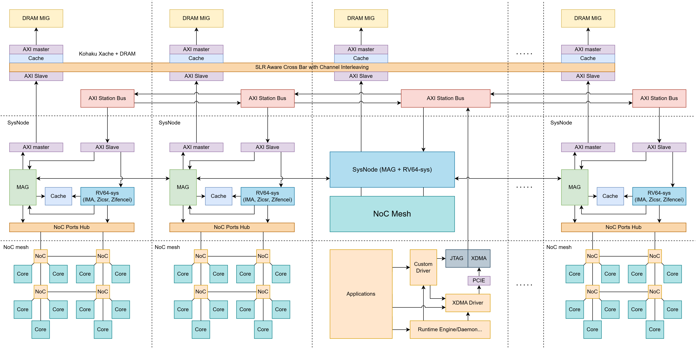
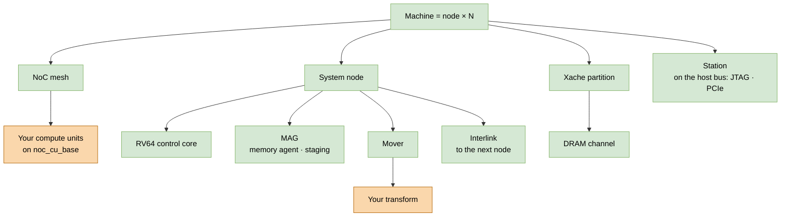
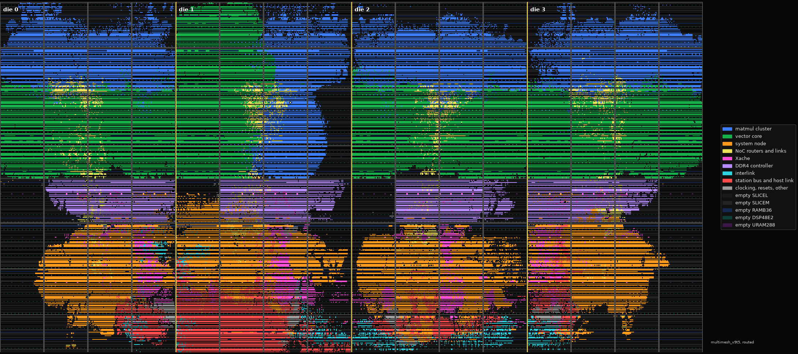
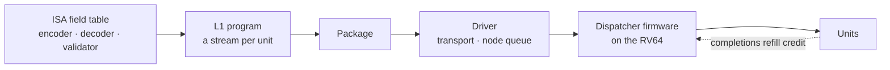
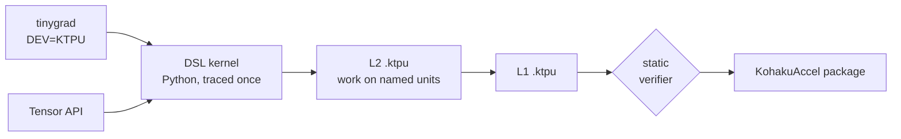

# KohakuAccel & KohakuTPU



**KohakuAccel is an open hardware and software platform for building
accelerators. KohakuTPU is the AI accelerator built on it, and the example
this page uses for every part of the platform. This repository holds both: the
RTL, the firmware, the compiler, the driver and the runtime.**

> Work in progress, built more for fun and for learning than for production. If
> you want to make it work for real, PRs are welcome.

ML research moves fast when there is a standard codebase to fork, like BasicSR
or taming-transformers. Accelerator research has none: every new machine
rebuilds the same host link, dispatch and memory plumbing before its first
interesting instruction runs. KohakuAccel is that codebase. **A new
accelerator is a new compute unit and a new instruction set; the
interconnect, the memory system, the control processor, dispatch, completion,
the compiler and driver stack are reused unchanged.** KohakuTPU is the first
machine built this way, and deliberately not the only one in the tree.

The platform names no device. Its RTL is written against generic memories,
FIFOs and clock-domain crossings, each vendor primitive behind a wrapper with a
portable replacement, so the same design targets another vendor's FPGA or an
ASIC flow. What belongs to one chip (how nodes map onto dies, the clocks, the
I/O, the floorplan) lives in the block design, the constraints and a top named
for that chip.

---

## The machine

**KohakuAccel.** A machine is a chain of **nodes** sharing one memory. A node
is complete on its own: a NoC mesh carrying the compute units, a system node
that owns the mesh's memory and dispatch, and a partition of the Xache in
front of its own DRAM channel. Everything in green below is the platform;
the orange slots are what a project writes.



- **A compute unit** attaches to the mesh at one port through `noc_cu_base`,
  which owns framing, discovery, credits and completion, so a unit conforms by
  construction. Its datapath, memories and instruction meaning are entirely
  its own.
- **The system node** is fused, not a set of peers: an RV64IMA core runs the
  dispatcher firmware, the memory agent (MAG) turns mesh traffic into memory
  traffic and holds a staging store, the mover walks strided descriptors with
  a transform slot on its read return, and the interlink carries pushes and
  doorbells to the next node.
- **The Xache** is a crossbar and cache in one, partitioned across the nodes:
  every node reaches every DRAM channel through one coherent address space,
  each partition boundary one registered, credited hop.
- **The station bus** carries host traffic (JTAG, PCIe through XDMA) along a
  line of stations, one per node, each on its own clock.

**KohakuTPU** fills the slots with two compute units and one transform:

- **Matmul cluster.** MXFP7 operands (int7 elements with an **E5M3** scale
  shared by a block of 32, a scale chosen so a block's peak always lands at
  full significand) multiplied in DSP48E2 chains: four tensor units cascade
  through `PCOUT -> PCIN`, so the multiply and the whole K=32 reduction happen
  inside the DSPs, double-pumped on a 2x clock. The fabric holds control, not
  arithmetic.
- **Vector core.** 16 E8M15 lanes with a transcendental unit each, and five
  engines fed by one instruction stream, so fills, drains and math overlap.
- **Transform.** The mover's slot holds the MXFP7 quantiser and a 4x4 granule
  transposer, so conversion happens while data moves.

Its current FPGA build places one node per die, two clusters and two vector
cores each, four nodes in all:



*The v9t5 build, routed, the four dies in a row as they abut: each die's mesh
on top, its DDR4 controller's column, then the system node and Xache partition;
the host link on die 1.*

| KohakuTPU | |
|---|---|
| **On silicon** | All four nodes: the RV64 system nodes boot the dispatcher firmware over JTAG, and every matmul cluster, vector core and mover runs its workload at the bring-up clock profile. |
| **Fixed, rebuilding** | A Vivado 2024.2 elaboration fault dropped a live term from one Xache ready between nodes 2 and 3; the RTL now writes those readies so no select can fold ([repro](tests/axi/diag/vivado_fold_repro.v)). |
| **In simulation** | The whole four-node card in Verilator, running the same firmware, driver and compiled programs as the silicon; every unit bench in xsim. |
| **In progress** | Timing closure at the target clocks (no frequency in this repository is a closed-timing result yet), and four clusters a node. |

Measured figures, each with the run it came from:
[results.md](docs/projects/kohakutpu/results.md).

---

## The software

**KohakuAccel.** One shared stack carries any project from instruction words
to a running unit. A project's program is an **L1 program**: one instruction
stream per unit and the node's sync points, packed into a **package** the
node's dispatcher firmware runs.



| | |
|---|---|
| **compiler** (`kohakuaccel.compiler`) | the ISA toolkit (a field table becomes an encoder, decoder, validator and disassembler), the L1 program, the package format and builder, the machine description |
| **driver** (`kohakuaccel.driver`) | transports (JTAG, PCIe, a Verilated card), discovery, node boot, the node queue, the card daemon |
| **firmware** (`software/firmware/kohakuaccel/`) | the RV64 dispatcher: queue service, package interpreter, unit enumeration and a unit-class registry |
| **simulation** (`kohakuaccel.simulation`) | the package interpreter and a simulated machine, so a project runs before it has RTL |

The framework imports nothing from any project, and a test fails the moment it
does.

**KohakuTPU** adds a language and compiler on top of that stack, and almost
nothing beneath it:



- **`.ktpu`**, a custom language with L2 (work on named units and memory
  spaces) and L1 (each unit's stream) in text, a compiler from one to the
  other, a Python DSL that traces into L2, and a tinygrad device that turns
  every scheduled kernel into a DSL kernel. Every level can be written by hand.
- **A static verifier** proves every compiled program free of deadlock and
  races before it reaches the card
  ([verify.md](docs/projects/kohakutpu/verify.md)).
- **Firmware:** KohakuTPU writes no dispatcher. It registers two unit classes
  (`software/firmware/kohakutpu/units/`, the matmul cluster and the vector
  core) with the dispatcher the platform provides.

```python
import kohakutpu.language.dsl as kt

@kt.kernel
def silu(x=kt.In("R", 128), y=kt.Out("R", 128), *, rows=kt.auto(16, 8)):
    for c in kt.par(kt.machine().vc, on=kt.vc):          # one instance a core
        for t in kt.range(x.shape[0] // 2 // rows):      # the core's stream loop
            r = c * (x.shape[0] // 2) + t * rows
            v = kt.load(x[r : r + rows, :])
            kt.store(y[r : r + rows, :], v * kt.recip(1.0 + kt.exp2(v * -kt.LOG2E)))
```

[tinygrad.md](docs/projects/kohakutpu/tinygrad.md) ·
[dsl.md](docs/projects/kohakutpu/dsl.md) ·
[ir/ktpu.md](docs/projects/kohakutpu/ir/ktpu.md)

---

## Build your own

The platform does not remove the design work; it removes **the connection
problem**. Ownership has four categories
([full table](docs/integrate/what-you-own.md)):

| | examples | may you change it |
|---|---|---|
| **Fixed protocol** | flit format, port handshake, memory encoding, credits | No: change it and you are off the platform |
| **Customizable addon** | the mover's transform slot, L2 staging, the endpoint adapter | Yes: that is what the slot is for |
| **Convention** | how a well-behaved unit is shaped, each marked *forced* or *free* | Follow or don't, but know which is which |
| **Yours** | datapath, memories, instruction semantics, pipeline depth | Entirely |

**The smallest proof is `saxpy`:** a second, unrelated accelerator built from
the platform alone. One instruction, `y = a*x + y`, as a unit
(`src/examples/saxpy/`), an ISA field table and a unit model
(`software/template/`). Composed into a generated mesh, its bench uploads
operands, dispatches, observes completion and reads the results back
bit-exact: `python scripts/py/xsim.py saxpy_mesh`. A project is these files:

```
src/examples/NAME/NAME_cu.v              your unit: datapath + noc_cu_base wrap
                  tokens_NAME.py         token -> instance text, for gen_mesh
                  NAME.map               the mesh picture
software/.../NAME/compiler/isa.py        how a shape becomes instruction words
                  driver/unit.py         the unit type, registered
                  simulation/unit.py     the model that stands in for the datapath
```

Start from [`docs/integrate/`](docs/integrate/README.md) and copy
`src/templates/cu/`, a conforming unit with a bench of its own; keep
`kh_port_check` mounted from day one.

---

## Quickstart

Python 3.13+ and [uv](https://docs.astral.sh/uv/) (`uv pip` only: the
workspace keeps no lock file).

```bash
python -m venv .venv && source .venv/bin/activate        # .venv\Scripts\activate on Windows
uv pip install -e software/language -e software/compiler -e software/driver \
               -e software/simulation -e software/application -e software/template
cd software && python -m pytest                           # no hardware, no card model
python -m toyaccel.application.run                        # the template project, end to end
```

KohakuTPU kernels run on a Verilated card model (setup:
[sim/verilator/docs/setup.md](sim/verilator/docs/setup.md)):

```bash
python scripts/py/card_model.py card_v9_1n_v2 --build-root build/v9g -d VEC_CORE_V2 -G DRAM_WORDS=1048576
python -m kohakutpu.application.ktpugrad --autoload       # once per environment
DEV=KTPU python software/application/examples/tinygrad/quickstart.py
```

For the RTL, **Verilator is the inner loop**, **xsim is the gate of record**
and **Vivado owns every resource and frequency number**
([simulate.md](docs/workflow/simulate.md)):

```bash
python scripts/py/vlt.py cluster_node --lint-only         # seconds, no C++ build
python scripts/py/xsim.py saxpy_mesh                      # the platform acceptance test
python scripts/py/check.py fast                           # no Vivado; tiers in its header
```

## Documentation

| | |
|---|---|
| [glossary](docs/glossary.md) | every project-specific word; start here if one is unfamiliar |
| [the platform](docs/integrate/README.md) | what you own, what is fixed, and how to put your own unit on it |
| [KohakuTPU](docs/projects/kohakutpu/README.md) | the machine top to bottom, in the order the decisions were forced |
| [architecture](docs/arch/README.md) · [specs](docs/spec/README.md) · [workflow](docs/workflow/README.md) | the mesh, system node and physical design; the normative contracts; build, measure and bring-up |

## Repository

```
src/kohakuaccel/     the platform hardware: station bus, system node, NoC, the RV64 and RV32 cores
src/kohakuaxi/       the Xache (crossbar + cache) and its partitioned form
src/kohakutransmit/  KTS, the credited link library the node crossings are built on
src/kohakutpu/       KohakuTPU: matmul, vector, transform, generated tops
src/kohakumpe/       a second project: the SIMT and SIMD processing elements
src/templates/       the extension points, each with its bench
src/examples/        saxpy, the platform acceptance test (RTL half)
software/            language, compiler, driver, simulation, firmware, application, template
tests/  scripts/     Verilog benches; build, simulate, measure
```

`src/kohakutpu/` is Verilog and `software/<component>/kohakutpu/` is Python
(and the firmware C): `src/kohakutpu/vector2/v2_core.v` is hardware,
`software/compiler/kohakutpu/compiler/encode/vector.py` is its encoder.

## License

All code in this repository is released under the **Kohaku Code License
2.0**: the RTL, the compiler, the driver, the documentation, and every other
resource in the tree. The license is open access with share-alike, with
commercial thresholds and a tape-out authorization rule for the hardware
design. Read [LICENSE](LICENSE) for the exact terms, and contact
kohaku@kblueleaf.net for custom licensing or exemptions.
